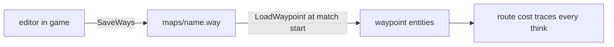
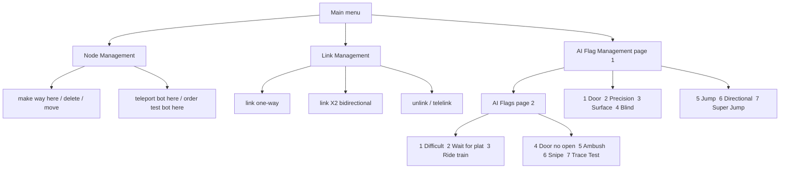
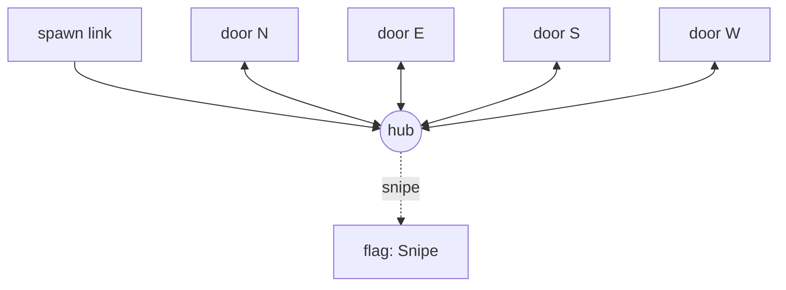
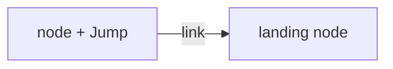
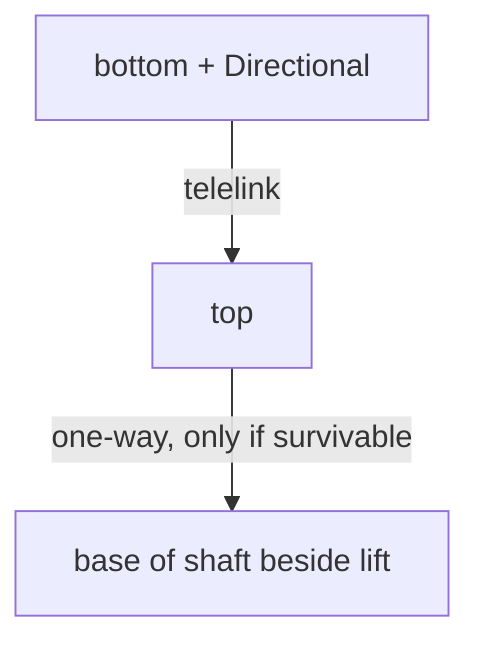
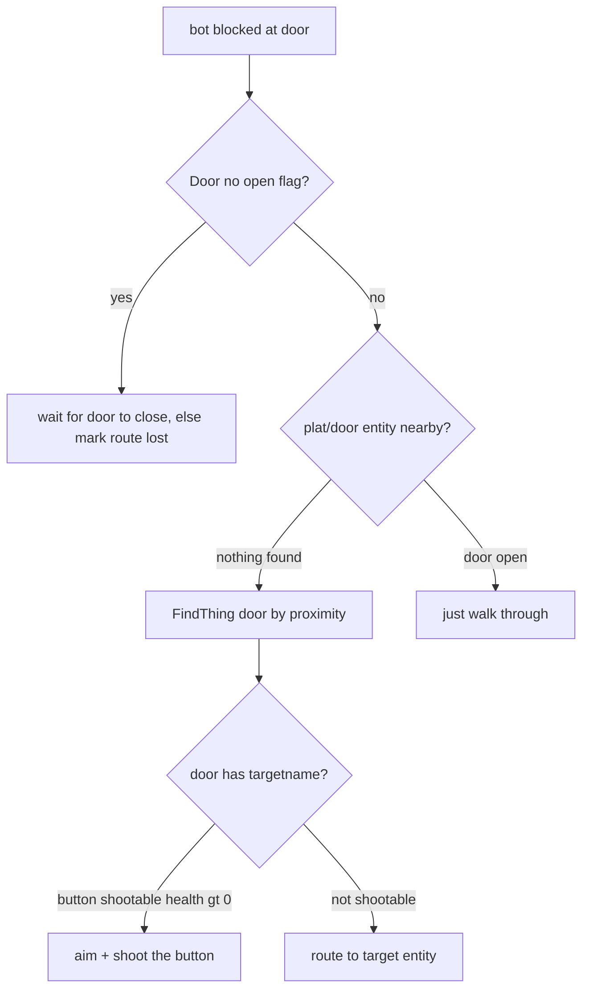
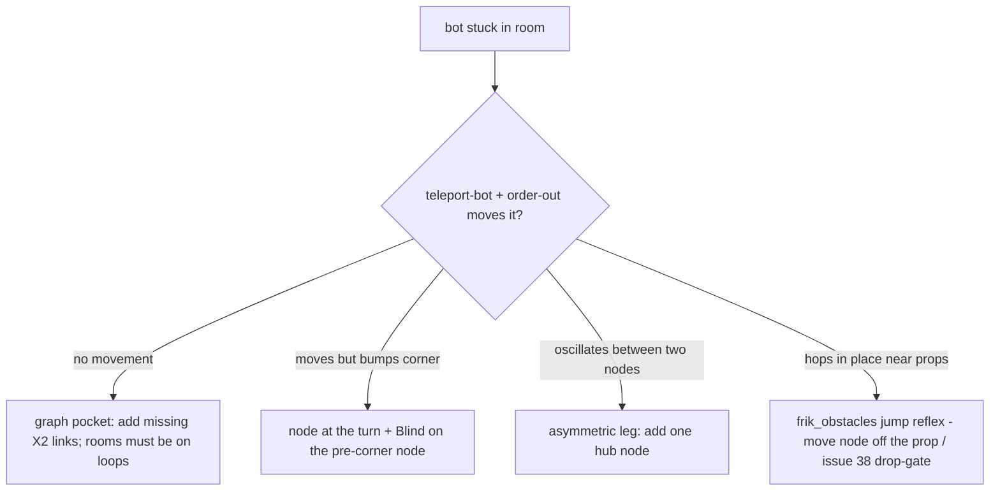

# Bot Waypointing Guide (Solitude)

How the FrikBot-derived bots navigate our maps: the `.way` files, the in-game
editor (`bot_ed.qc`), every AI flag, and the patterns used on narrows,
highground, and pit3. Diagrams are Mermaid; GitHub renders them.

External references at the bottom. Flag values and behaviors below were read
from `qcc-src/frikbot/bot.qc` and `bot_ai.qc` in this repo, not from upstream
docs, so they match what actually ships.

---

## 1. What a .way file is

Plain text, one block per waypoint, written by the game itself:

- Header: `// Ways by player <name>`.
- Per node: `saved1/2/3` = origin x/y/z, `scratch1..4` = up to four target
  node numbers (the outgoing links), `saved4` = the AI flags encoded as
  `flags * 4 + 1` (bidirectional) or `+ 2` (one-way link marker).
- Loader: `bot.qc` `LoadWaypoint` (`bot.qc:1219-1237`), auto-loaded per map
  from `solitude/maps/<name>.way` when `max_clients >= 2`.
- Writer: `SaveWays` (`bot_ed.qc:1617+`) saves straight to `maps/<name>.way`
  from the running server. No offline baker exists; the editor IS the tool.

Important consequence: **route costs are not stored**. Distances, visibility,
and jump feasibility are recomputed at runtime by traces. If physics change
(e.g. the Halo-3 movement model in issue #48), costs self-heal. What goes
stale is only human judgment: which links exist, which are one-way, and the
telelinks.

## 2. Entering the editor

Requirements: a real match (matchmaking or local server with bots, NOT
single-player `map foo` - `max_clients < 2` disables waypoint loading and bot
connecting).

| Key | Impulse | Action |
|-----|---------|--------|
| `n` | 104 | toggle waypoint editor (WM_EDITOR) |
| `=` | 100 | connect a test bot (same team) |
| `-` | 102 | kick a bot |
| `v` | 103 | bot cam (spectate a bot's view) |

Impulses 100-103 are inert outside editor mode (gated in `BotImpulses`,
commit `e2c5c2a7`), so they cannot fire mid-fight by accident.

Selecting a node: walk near it - the nearest waypoint lights as a gold
ball. Menu toggles then edit **the selected node**. `Hold Select` (main menu)
freezes the selection while you fly past neighbors - use it constantly when
repositioning.

## 3. Editor menu map

## 4. Links and direction

A link is an edge: "a bot can physically traverse from node A to node B".

- **link** - normal traversable edge; cost computed at runtime.
- **telelink** - instant transit, zero cost. Use ONLY for real teleports and
  gravity lifts. A faked telelink makes the bot walk into a wall.
- Directions are per-edge. Default to `X2` (bidirectional) for anything flat.
  One-way is reserved for: drops (down yes, up no), boost jumps (up yes,
  down no), lifts and one-way portals (bottom to top only).
- Every node holds up to 4 outgoing targets. Hub with more than 4 exits:
  stack two twin nodes linked together.
- No islands: BFS from every spawn should reach the whole graph. No
  super-long non-teleport links; they defeat the PVS-style visibility logic.

## 5. AI flag reference

From `bot.qc:173-189`. "Consulted" says when the engine reads the flag:
`plan` = during route selection, `arrive` = when the bot reaches the node,
`route-test` = revalidated when a route is chosen.

| Key | Flag | Value | Consulted | Meaning / placement |
|-----|------|-------|-----------|---------------------|
| p1-1 | Door | 16 | plan, arrive | node sits at a door; blocked bot works the door machinery (see section 7) |
| p1-2 | Precision | 32 | arrive | land exactly here; rails, narrow beams, narsp catwalks |
| p1-3 | Surface | 64 | arrive | air-surface jump helper; niche, skip |
| p1-4 | Blind | 128 | plan | next node not visible from here; bot commits without re-aiming (corners, occluded links) |
| p1-5 | Jump | 256 | arrive | jump on arrival - takeoff node of a gap; pair with landing node |
| p1-6 | Directional | 512 | plan, arrive | must arrive facing a direction; lift-shaft entry, crouch approaches |
| p1-7 | Super Jump | 4096 | arrive, route-test | rocket-jump edge; sets impulse 7 + 80-degree pitch; route-tests `bot_can_rj`, marks lost if false |
| p2-1 | Difficult | 65536 | route-test | cost penalty; cheese edges you want used only when clearly best |
| p2-2 | Wait for plat | 1024 | arrive | bottom node of a moving platform: wait for it |
| p2-3 | Ride train | 2048 | arrive | node rides a mover (door elevators included) |
| p2-4 | Door no open | 32768 | plan | never attempt this door (slime/key/secret); blocked = give up |
| p2-5 | Ambush | 16384 | arrive | camp spot off main flow; a handful per map |
| p2-6 | Snipe | 8192 | arrive | designated sniper nest; tag 1-3 per map |
| p2-7 | Trace Test | 131072 | route-test | re-verify visibility; conditional/breakable paths |
| - | telelink bits | 1/2/4/8 | per edge | which of target1-4 is a telelink (stored in saved4 encoding) |

## 6. Patterns

### Hub instead of ring (pit3, big rooms)

A square room with four doors: 1 hub + the doorway nodes, not a 6-node
perimeter. Hub is also where item visibility comes free.

### Gap jump (highground ledges)

Takeoff node 20-30 units BEHIND the lip, flagged Jump; landing node on the
far side. Never node mid-air.

### Gravity lift / shaft (narrows)

Shaft floor node flagged Directional, telelink up; top node gets a one-way
walk-off or jump-off link back down if survivable.

No link from any rail node toward open water - if the drop is lethal
(bots' own airshot math treats ~450+ units as kill territory), do not build
the edge at all.

### Lifts vs platforms

Moving BRUSH platform: Wait-for-plat at the floor node, Ride-train ON the
platform. Velocity-column lift (Solitude's style): telelink bottom to top is
the reliable model.

## 7. Door playbook

What the code does (`bot_ai.qc:343-381` arrive, `:547-575` blocked trace):

`FindThing("door")` is a proximity guess ("crossfingers" in the source
comment): **one door per waypoint** - two doors in one vestibule can latch the
wrong one; use two nodes, one per door.

| Door type | What to flag |
|-----------|--------------|
| walk-up trigger opener | nothing (add Door only if it stays closed between uses) |
| shootable button | Door |
| timed / iris | Door (waits instead of mashing) |
| +use button (unshootable) | bots cannot press buttons: telelink pair across it, or route around |
| slime / key / secret | Door + Door no open |
| platform-door you ride | Ride train |

## 8. Density: how many nodes, where

- One node per decision point; straight sight-lines take zero intermediate
  nodes. If A sees B down a 2000-unit corridor, one link, done.
- Items need nodes only when hidden behind geometry; bots path at items they
  can see from route nodes.
- Corners need a node (they are steering points); Blind then lets the NEXT
  leg target a node just past the corner instead of chaining.
- Nodes float 24-40 units above the floor.
- Targets: narrows ~25-30, highground ~35, pit3 ~40 (center is a fight arena,
  keep its hub walkable).
- Map menu hotspots from `tools/asset-scan/MAP-AUDIT.md` correlate with
  decision density - audit cells with high face counts are usually rooms.

## 9. Build workflow for a new map

1. Start a match (8+ bots fine), `n` to enter editor, `=` to connect a test
   bot.
2. Walk the intended patrol route with a node at every decision (section 8).
3. Link as you go: X2 for flat, one-way for drops/boosts/lifts, telelink only
   for real teleports/lifts.
4. Flag passes: Jump on takeoffs, Precision on rails, Directional on shafts,
   Door on door nodes, Snipe/Ambush on the nests you actually want.
5. Audit with the test bot: `teleport-bot-here` at a node, `order-test-bot-here`
   to the next - if the bot never moves or bumps geometry, fix the edge now.
6. `bot cam` (`v`) to see what the bot sees on the full route.
7. SaveWays writes `maps/<name>.way`. Commit it next to the map.

## 10. Stuck-in-a-room triage

## 11. External references

- FrikBot X readme (the menu system `bot_ed.qc` mirrors 1:1):
  `insideqc.com/frikbot/fbx/readme.html`
- FrikaC waypoint depot - downloadable stock `.way` files for classic DM maps.
- Quake 2021 Remaster Steam navigation guide 2580864534 - link-type taxonomy
  (Elevator Top/Bottom, Pusher, CheckForHazard) worth stealing ideas from.
- `github.com/DrLex0/quake-frogbots` + Mick's classic waypointing guide -
  warning that applies to us too: custom `.ent` files shift marker numbering
  and corrupt waypoint data.
